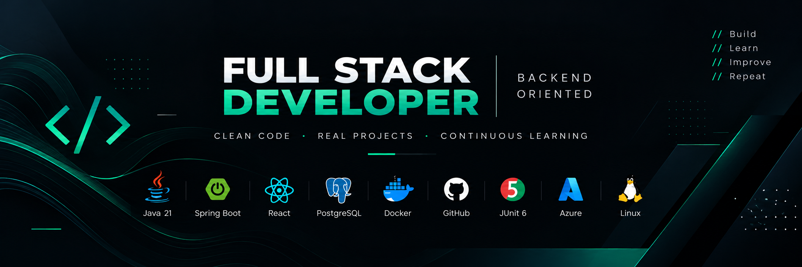

```md
<p align="center">
  
</p>

<h1 align="center">¡Hola! Soy Miguel Ángel 👋</h1>

<p align="center">
  <strong>Full Stack Developer · Backend Oriented</strong>
</p>

<p align="center">
  Java · Spring Boot · React · PostgreSQL · Docker · Testing · Git · Azure
</p>

---

## 👨‍💻 Sobre mí

Soy desarrollador de software con formación en **Desarrollo de Aplicaciones Web (DAW)** y actualmente estoy orientando mi carrera hacia el desarrollo **Backend con Java**.

Me gusta construir software entendiendo lo que ocurre detrás de cada capa: dominio, lógica de negocio, persistencia, APIs, testing, infraestructura y despliegue.

Aunque puedo trabajar tanto en frontend como en backend, mi especialización está cada vez más centrada en:

**Java · Spring Boot · PostgreSQL · Docker · Testing**

Para la parte frontend utilizo principalmente **React**.

Mi objetivo es seguir evolucionando como desarrollador y construir progresivamente un perfil que combine:

```text
Backend Java → Cloud → DevSecOps → Application Security
```

---

## 🚀 Actualmente

🔨 Desarrollando proyectos personales para aplicar conceptos reales de ingeniería de software.

📚 Profundizando en:

- Java 21
- Spring Boot
- APIs REST
- PostgreSQL
- JUnit 6
- Maven
- Docker
- React
- Git y GitHub
- Microsoft Azure

🧪 Aplicando buenas prácticas como:

- Clean Code
- Testing automatizado
- Arquitectura por capas
- Pull Requests
- Issues
- Conventional Commits
- Git Flow
- CI/CD
- Code Review
- Seguridad en el ciclo de desarrollo

---

## 🛠️ Stack principal

<div align="center">

  
  

  
  

  
  

  
  

  
  

  
  

  
  

  
  

  

</div>

<br>

<p align="center">
  <code>Java 21</code>
  <code>Spring Boot</code>
  <code>React</code>
  <code>PostgreSQL</code>
  <code>Docker</code>
  <code>JUnit 6</code>
  <code>Maven</code>
  <code>Git</code>
  <code>Azure</code>
  <code>Linux</code>
</p>

---

## 🧠 Experiencia con otras tecnologías

A lo largo de mi formación y experiencia previa también he trabajado con:

`JavaScript` · `TypeScript` · `PHP` · `Laravel` · `Symfony` · `Angular` · `MySQL` · `HTML` · `CSS`

Estas tecnologías forman parte de mi base como desarrollador Full Stack, aunque actualmente mi especialización está orientada al ecosistema **Java Backend**.

---

## ☁️ Hacia dónde estoy evolucionando

Actualmente estoy ampliando mi perfil en:

### Backend
- Java avanzado
- Spring Boot
- Arquitectura de aplicaciones
- APIs REST
- Persistencia y bases de datos
- Testing

### Cloud
- Microsoft Azure
- Contenedores
- CI/CD
- Automatización

### Seguridad
- Secure Coding
- DevSecOps
- Application Security
- Seguridad en APIs
- Gestión de vulnerabilidades

### Frontend
- React
- TypeScript
- Integración con APIs REST

---

## 🧩 Cómo trabajo

Intento tratar mis proyectos personales como proyectos reales:

```text
Issue
  ↓
Branch
  ↓
Code
  ↓
Tests
  ↓
Commit
  ↓
Pull Request
  ↓
Code Review
  ↓
Merge
```

Utilizo ramas por funcionalidad, commits pequeños, Pull Requests y testing para mejorar tanto el código como mi forma de trabajar con GitHub.

---

## 🎯 Principios

```text
Build.
Test.
Learn.
Improve.
Repeat.
```

Me interesa más entender bien una tecnología y aplicarla correctamente que acumular herramientas sin profundidad.

Mi objetivo es seguir construyendo una base sólida como desarrollador y mejorar proyecto a proyecto.

---

## 🎓 Formación

🎓 **Técnico Superior en Desarrollo de Aplicaciones Web (DAW)**

📍 España

☁️ Actualmente ampliando conocimientos en Microsoft Azure.

---

## 📫 Contacto

<p align="center">

  <a href="mailto:ma.laragcia@gmail.com">
    📧 Email
  </a>
  &nbsp;&nbsp;•&nbsp;&nbsp;
  <a href="https://linkedin.com/in/miguel-angel-lara-garcia-96082b207">
    💼 LinkedIn
  </a>

</p>

---

<p align="center">
  <i>Siempre aprendiendo. Siempre construyendo.</i>
</p>
---